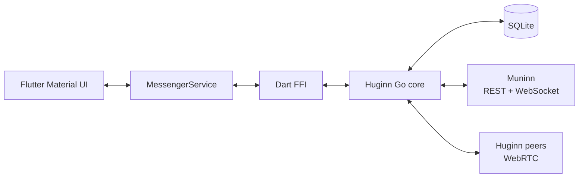

# Huginn Messenger — Flutter client

Кроссплатформенный Flutter-клиент P2P-мессенджера Huginn. UI написан на Dart,
а криптография, WebRTC, офлайн-доставка и SQLite реализованы в отдельном
Go-ядре. Клиент собирает его из submodule `src/huginn-messenger`, обновляя
исходники до последнего коммита `main`, и подключает через C ABI/Dart FFI.

Muninn используется для обнаружения endpoints, signaling и хранения метаданных
зашифрованных чанков. Тексты сообщений и содержимое файлов передаются между
Huginn-пирами.

## Возможности

- личные и групповые чаты;
- E2E-шифрование и подписи;
- прямая WebRTC-доставка и резервные offline chunks;
- отправка, фоновая загрузка и открытие файлов;
- ответы, пересылка и текстовые стикеры: свои стикеры, создание из сообщения,
  новые категории и настройка их порядка;
- поиск пиров и групп от трёх символов;
- relogin через текстовый ключ или QR-код;
- уведомления Android/Linux/macOS; на Android/macOS — переход в чат по нажатию;
- настройка Muninn, chunk TTL и TURN.
- проверка новых версий и загрузка установочных пакетов из GitHub Releases.

Успешная отправка с обновлённым ядром означает сохранение сообщения и
зашифрованных вложений в SQLite для фоновой доставки. Очередь переживает
перезапуск. При ошибке подготовки клиент показывает причину и сохраняет текст
и непринятые вложения в редакторе; уже принятые вложения повторно не отправляются.
Исправления очереди должны присутствовать в `main` ядра; библиотека
пересобирается вместе с клиентом.

## Архитектура



Подробности:

- [архитектура Flutter-приложения](docs/flutter-application.md);
- [архитектура Go-ядра](https://github.com/killbane1232/huginn-messenger/blob/main/docs/architecture.md);
- [README Go-ядра](https://github.com/killbane1232/huginn-messenger).

## Поддерживаемые сборки

| Платформа | Состояние |
|---|---|
| Android | Библиотеки четырёх ABI собираются из submodule через `build.sh` |
| Linux | Библиотека собирается из submodule и упаковывается через CMake |
| macOS | Apple Silicon и Intel; Go framework и release runner через `scripts/build-apple.sh macos` |
| iOS | Устройство arm64 и симулятор arm64/x86_64; статическое Go XCFramework через `scripts/build-apple.sh ios` |
| Windows | Flutter runner есть, но native DLL не входит в `build.sh` |

## Подготовка

```bash
/usr/local/flutter/bin/flutter pub get
```

`build.sh` и GitHub Actions вызывают `scripts/build-core-libraries.sh`, который
обновляет submodule командой `git submodule update --init --recursive --remote
--checkout -- src/huginn-messenger` и компилирует shared libraries. В
`.gitmodules` задано `branch = main`. Git всё равно хранит SHA подмодуля, но
перед каждой сборкой скрипт получает последний `main`; использованный SHA
выводится в лог. При ошибке обновления или незакоммиченных изменениях ядра
сборка останавливается. Для обновления нужен доступ к Git remote.

Сборочный скрипт запускается на Linux. Нужны Git, Go, C-компилятор, Flutter,
Android SDK/NDK для Android и Linux desktop dependencies для Linux.
Путь к NDK можно задать через `ANDROID_NDK_HOME` или `ANDROID_NDK_ROOT`;
иначе выбирается последняя установленная версия из `$ANDROID_HOME/ndk`
(`ANDROID_SDK_ROOT` или `~/Android/Sdk` используются как запасные пути).
CI устанавливает NDK `28.2.13676358`.

Отдельная сборка библиотек перед прямым вызовом `flutter build`:

```bash
scripts/build-core-libraries.sh linux    # только Linux
scripts/build-core-libraries.sh android  # только Android, четыре ABI
scripts/build-core-libraries.sh          # Linux и Android
```

## Проверка

```bash
/usr/local/flutter/bin/flutter analyze
/usr/local/flutter/bin/flutter test
```

Нативный тест ошибок отправки, сохранения очереди и настройки Muninn запускается
с пересобранной Linux-библиотекой:

```bash
scripts/build-core-libraries.sh linux
HUGINN_NATIVE_TESTS=1 LD_LIBRARY_PATH="$PWD/native/linux/amd64" \
  /usr/local/flutter/bin/flutter test
```

На Linux ARM64 используйте `native/linux/arm64`. Проверка обновления submodule
и сборочного скрипта без доступа к сети: `python3 scripts/test_build_core.py`.

## Сборка macOS и iOS

Нужны macOS, полный Xcode с macOS/iOS SDK, Flutter (Dart >= 3.12.2), Go и
CocoaPods. Одних Xcode Command Line Tools недостаточно для Flutter runner.
Минимальные версии приложения: macOS 13 и iOS 15. CocoaPods используется для
плагинов и локального Go-ядра; Swift Package Manager отключён в `pubspec.yaml`.

После установки и первого запуска Xcode:

```bash
sudo xcode-select --switch /Applications/Xcode.app/Contents/Developer
sudo xcodebuild -runFirstLaunch
brew install cocoapods
flutter doctor -v
scripts/build-apple.sh         # анализ, тесты, macOS release, iOS release и simulator
scripts/build-apple.sh macos   # только macOS
scripts/build-apple.sh ios     # только iOS
```

На macOS `./build.sh` вызывает ту же Apple-сборку. В GitHub Actions workflow
`Tests` добавлена отдельная macOS job для обеих платформ; его можно запустить
вручную. Job сохраняет ZIP-архивы macOS, iOS без подписи и iOS simulator.

Если Flutter или Go отсутствуют в PATH, задайте `FLUTTER_BIN` и `GO_BIN`
полными путями к исполняемым файлам. Скрипты запускаются из любого каталога.

Результаты:

- macOS: `build/macos/Build/Products/Release/huginn_messenger.app`;
- iOS release без подписи: `build/ios/iphoneos/Runner.app`;
- iOS simulator debug: `build/ios/iphonesimulator/Runner.app`.

Сборка iOS без подписи проверяет компиляцию для устройства. Для установки на
iPhone или создания IPA выберите свою Team в `ios/Runner.xcworkspace` и
настройте подпись; после этого можно выполнить `flutter build ipa --release`.

Отдельная сборка ядра перед прямым вызовом `flutter build`:

```bash
scripts/build-apple-core.sh macos
scripts/build-apple-core.sh ios
```

macOS получает универсальный динамический `huginn_messenger.framework`;
iOS — `HuginnCore.xcframework` со статическими архивами для устройства и
симулятора. CocoaPods упаковывает ядро в runner; iOS сохраняет экспортированные
`messenger_*` символы для `DynamicLibrary.process()` даже в release.
Собранные `ios/Frameworks/` и `macos/Frameworks/` игнорируются Git.
Фактический SHA ядра записывается в `native/apple/core-revision.txt`.

Нативная проверка на macOS использует собранный framework:

```bash
HUGINN_NATIVE_TESTS=1 \
HUGINN_LIBRARY_PATH="$PWD/macos/Frameworks/huginn_messenger.framework/huginn_messenger" \
  flutter test
```

Проверка нативного запуска macOS (значок строки меню, иконка Dock и повторное
открытие окна) выполняется без загрузки пользовательской базы и сетевых
соединений:

```bash
flutter build macos --debug --target test/native_ui_host.dart
xcodebuild test -workspace macos/Runner.xcworkspace -scheme Runner \
  -configuration Debug -destination 'platform=macOS,arch=arm64' \
  -parallel-testing-enabled NO FLUTTER_TARGET="$PWD/test/native_ui_host.dart"
flutter build macos --debug   # вернуть обычное приложение вместо тестового host
```

Иконки macOS генерируются командой `swift scripts/generate-macos-icons.swift`
из `macos/AppIcon-source.png`. Скрипт выравнивает видимый контур до квадрата
824 × 824 на холсте 1024 × 1024, задаёт одинаковые скругления и прозрачные поля,
затем создаёт все размеры AppIcon. После обновления иконок пересоберите приложение.

## Release-сборка Android и Linux

```bash
./build.sh
```

Скрипт:

1. обновляет Go-submodule до последнего `main` и собирает Linux и Android libraries;
2. размещает Android libraries в `android/app/src/main/jniLibs`;
3. собирает release APK;
4. упаковывает Linux library в release bundle.

Результаты:

- `build/app/outputs/flutter-apk/app-release.apk`;
- `build/linux/x64/release/bundle/`.

Собранные `.so`, Flutter `build/`, `.dart_tool/`, `.gradle/` и platform
`ephemeral/` не должны редактироваться вручную или попадать в коммиты.

## Структура проекта

```text
lib/main.dart                         Material UI and navigation
lib/src/models/                       Dart models
lib/src/services/messenger_service.dart
lib/src/services/event_poller.dart
lib/src/services/notification_service.dart
lib/src/services/platform_service.dart
lib/src/ffi/messenger_bridge.dart     manual Dart FFI wrapper
src/huginn-messenger/                 Go core submodule (main)
scripts/build-core-libraries.sh       submodule update and native build
native/linux/                         compiled Linux library (ignored)
android/                              Android runner and Kotlin channels
linux/                                Linux runner and CMake library packaging
test/                                 Flutter tests
docs/                                 Flutter documentation
```

## Обновления из GitHub

В **Settings → App updates** отображается установленная версия. Кнопка
**Check for updates** проверяет последний стабильный релиз в
`killbane1232/huginn-messenger-flutter`; **Install update** скачивает пакет,
проверяет размер и SHA-256 из GitHub API и открывает системный установщик.
Завершите установку в его окне и перезапустите Huginn. Если пакета для текущей
платформы нет, кнопка установки недоступна. Сетевые ошибки можно повторить;
незавершённые или повреждённые загрузки не передаются установщику.

- Android: APK. При первом обновлении разрешите Huginn устанавливать приложения
  и повторно нажмите **Install update**; проверенный файл используется повторно.
  Обновление должно иметь ту же Android-подпись, что установленное приложение.
- macOS: универсальный PKG для Apple Silicon и Intel, установка в `/Applications`.
  Если macOS блокирует скачанный пакет, нажмите **Allow installation…**:
  откроются системные настройки **Privacy & Security**. В разделе Security
  выберите **Open Anyway** для указанного PKG и подтвердите действие в macOS.
  Если установщик не открылся, вернитесь в Huginn и нажмите **Install update**
  повторно; проверенный пакет не скачивается заново. Кнопка появляется после
  загрузки и проверки пакета и сама не выдаёт разрешение на установку.
  Текущий workflow не настраивает Developer ID Installer и notarization; пакет
  без них может потребовать разрешения macOS. Подпись и notarization нужны для
  распространения без предупреждений Gatekeeper.
- Linux: DEB для x64, собранный на Ubuntu 24.04; нужен графический обработчик
  DEB через `xdg-open`. При его отсутствии ошибка содержит путь к скачанному
  пакету для ручной установки. Старые распакованные копии приложения остаются
  на месте; запускайте установленную версию. Путь к базе Linux по-прежнему
  зависит от рабочей директории, поэтому сохраняйте её при переходе с bundle.
- iOS и Windows: установка GitHub-пакетов не поддерживается.

Workflow **Build & Release** на тегах `v<SemVer>` запускает release-сборку
из защищённой ветки `main`, разрешённой средой `AndroidEnv`. Перед использованием
ключа подписи workflow проверяет, что тег указывает на коммит, уже влитый в
`main`, и собирает именно этот коммит. После успешной сборки трёх пакетов
публикуется GitHub Release. Flutter закреплён на версии `3.47.6` для
совместимости с Android Gradle wrapper.

Для повторного выпуска существующего тега запустите workflow вручную из `main`
и укажите `release_tag`, например `v1.0.1`. Ручной запуск с пустым полем
сохраняет только артефакты Actions. Теги с prerelease-суффиксом публикуются как prerelease и
не предлагаются клиентом. Имена файлов стабильного релиза:

```text
huginn-messenger-<version>.apk
huginn-messenger-<version>-macos-universal.pkg
huginn-messenger-<version>-linux-x64.deb
```

Версия в APK, Linux-приложении и macOS bundle задаётся из тега. Проверка
сравнивает SemVer без build metadata; для выпуска обновления увеличивайте
версию, например `v1.0.1`. До первой публикации нового release workflow
клиент сообщает об отсутствии релиза или совместимого пакета.

## Конфигурация

Начальный адрес Muninn задаётся ключом `muninn` в `assets/config.json`,
который включается в сборку. Измените этот файл перед сборкой для своего
сервера. При следующих запусках используется адрес, сохранённый в SQLite.
Поле **Settings → Muninn server** сохраняет новый адрес и сразу пересоздаёт
подключение; одновременно можно изменить login.

Для этой загрузки конфигурации нужна обновлённая shared library ядра: пустой
адрес в `messenger_create` загружает SQLite и возвращает `-4`, если адрес
ещё не задан. Изменения ядра должны быть в `main` перед сборкой клиентов.

Остальные значения по умолчанию:

- chunk TTL: `1w`;
- SQLite: `huginn.db`;
- TURN: выключен до задания адреса.

На Android/iOS/macOS база размещается в application documents directory, на остальных desktop
относительный путь разрешается от рабочей директории.

## Разработка FFI

Источником истины C ABI являются экспортированные функции в
[`bridge.go`](https://github.com/killbane1232/huginn-messenger/blob/main/bridge.go)
репозитория ядра. Изменение ABI нужно синхронно провести через:

1. Go exports;
2. C header;
3. `lib/src/ffi/messenger_bridge.dart`;
4. при необходимости generated bindings;
5. обновление `main` ядра, пересборку shared library и целевой Flutter-платформы.

`flutter analyze` не проверяет runtime ABI и сетевое поведение Go-ядра.
