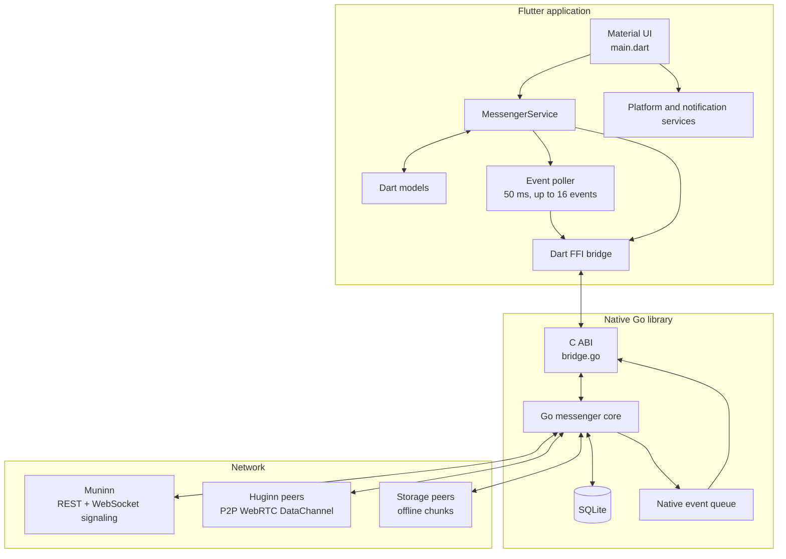
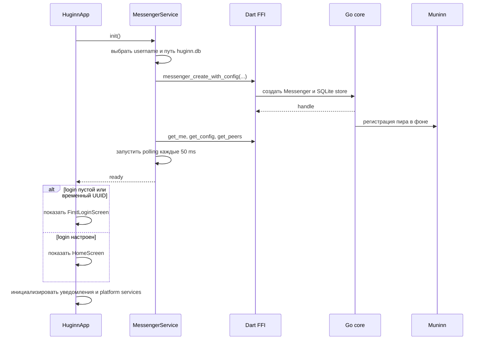
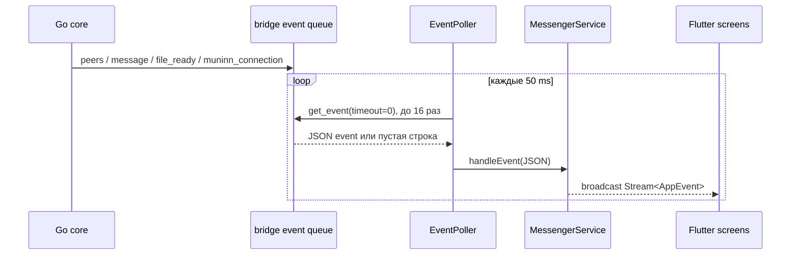

# Flutter-приложение Huginn Messenger

Этот документ описывает актуальный Flutter-клиент из каталога
`huginn_messenger`. Сетевой протокол, криптография, WebRTC и SQLite-хранилище
сообщений находятся в Go-ядре из submodule `src/huginn-messenger`. Стикеры
хранятся отдельно во фронтенде в `frontend.sqlite`. При сборке
исходники обновляются до последнего `main`, компилируются в shared library
и подключаются через C ABI и Dart FFI.

Документ составлен по состоянию кода на 11 августа 2026 года. Раздел
[Сверка с существующими схемами](#сверка-с-существующими-схемами) фиксирует
границы Flutter, standalone Go UI и Muninn после синхронизации документации.

## Назначение приложения

Flutter-клиент предоставляет пользовательский интерфейс для:

- первого входа и переноса существующей идентичности;
- поиска прямых контактов и групп;
- личных и групповых чатов;
- отправки текста, файлов и текстовых стикеров;
- ответов на сообщения и пересылки;
- локальных уведомлений и перехода в чат по нажатию на уведомление;
- список серверов Muninn и TTL чанков;
- открытия загруженных вложений средствами операционной системы.

Flutter не реализует собственный сервер сообщений. Muninn используется для
регистрации и обнаружения пиров, WebRTC-сигналинга и метаданных офлайн-чанков.
Содержимое сообщений и файлов передаётся между Huginn-пирами.

## Архитектура



### Границы ответственности

| Слой | Ответственность |
|---|---|
| `lib/main.dart` | Навигация, экраны, состояние виджетов и пользовательские действия |
| `lib/src/services/` | Фасад Go-ядра, поток событий, уведомления и платформенная интеграция |
| `lib/src/models/` | Dart-представления конфигурации, пиров, групп, сообщений и событий |
| `lib/src/ffi/messenger_bridge.dart` | Ручная загрузка динамической библиотеки и вызовы экспортированного C ABI |
| upstream `bridge.go` | Таблица native-инстансов, JSON-контракт с Dart и очередь событий |
| upstream `internal/` | Криптография, доставка, WebRTC, Muninn-клиент и SQLite-хранилище |
| platform runners | Упаковка native-библиотеки и функции конкретной ОС |

Ключевые правила границы Flutter/Go:

- каждый вызов FFI получает числовой `handle` native-инстанса;
- сложные аргументы и результаты передаются как JSON-строки;
- строки, выделенные Go, Dart освобождает через `messenger_free_string`;
- изменение C ABI должно одновременно обновлять `bridge.go`, заголовок и
  Dart-обёртку;
- логика доставки и хранения не должна дублироваться в UI.

## Структура Flutter-проекта

```text
huginn_messenger/
├── lib/
│   ├── main.dart                         # Material UI и навигация
│   ├── huginn_messenger.dart             # публичные Dart-экспорты
│   ├── huginn_messenger_bindings_generated.dart
│   └── src/
│       ├── ffi/messenger_bridge.dart      # используемая ручная FFI-обёртка
│       ├── models/                        # AppConfig, Peer, GroupChat и сообщения
│       └── services/                      # messenger, events, platform, notifications
├── test/                                  # Flutter unit/widget tests
├── android/                               # Android runner, Kotlin channels и jniLibs
├── linux/                                 # Linux runner и упаковка готовой библиотеки
├── ios/ macos/                           # Apple runners + локальное Go-ядро
├── windows/                              # runner без полной сборки в build.sh
├── src/huginn-messenger/                  # Go core submodule, branch = main
├── native/linux/                          # собранная Linux library, ignored
├── scripts/build-core-libraries.sh        # обновление main и сборка ядра
├── pubspec.yaml
└── build.sh                               # сборка core + Android + Linux
```

`lib/main.dart` пока содержит большую часть экранов в одном файле. При
дальнейшем разделении важно сохранить один долгоживущий `MessengerService` на
уровне `HuginnApp` и передавать его дочерним экранам.

## Жизненный цикл приложения



При первом запуске Dart создаёт временный UUID, если имя пользователя ещё не
известно. `FirstLoginScreen` требует обычный непустой login либо позволяет на
Android считать QR-код relogin. После смены login или успешного relogin
`MessengerService` уничтожает старый native-инстанс и создаёт новый с той же
базой данных.

При завершении Flutter отменяет подписки и таймер, вызывает
`messenger_destroy`, останавливает Android foreground service и закрывает
контроллеры потоков.

## Идентификаторы

В приложении различаются три значения:

- `peer_id` — идентификатор конкретного WebRTC endpoint;
- `login` — отображаемое имя пользователя;
- `Peer.key` — ключ маршрутизации вида `login:signature_key`.

В UI показывается `Peer.displayLogin`, а для открытия чата, поиска истории и
отправки используется полный ключ. Для группы ключом чата служит её `uid`.
Смешивание отображаемого имени и ключа маршрутизации приводит к объединению
разных собеседников или к загрузке чужой истории.

## Экраны и пользовательские сценарии

### Первый вход

`FirstLoginScreen` появляется, если сохранённый login пуст или имеет вид UUID.
Доступны два сценария:

1. Ввести новый login. Значение сохраняется в конфигурации Go-ядра, после чего
   native-инстанс пересоздаётся.
2. На Android считать relogin QR-код с другого устройства и импортировать
   идентичность и локальное состояние.

### Главный экран

`HomeScreen` показывает группы и прямые контакты в общем списке. С экрана можно:

- обновить список pull-to-refresh;
- создать группу;
- открыть личный или групповой чат;
- перейти в настройки;
- искать пиры и группы.

Поиск начинается только после трёх символов. До достижения порога показывается
обычный список, а события обновления пиров продолжают использоваться как
основной источник состояния.

### Чат

`ChatScreen` загружает последние 64 сообщения и добавляет более старые страницы
при прокрутке к началу списка. Событие применяется только к чату с совпадающим
`chat_id`; для старых событий без `chat_id` сообщение дополнительно сверяется с
историей текущего чата.

Поддерживаются:

- текст и несколько файлов за одну пользовательскую отправку;
- предпросмотр локальных изображений;
- открытие загруженного файла по нажатию;
- ответы и пересылка, закодированные в обычном тексте;
- папки текстовых стикеров, создание, перемещение и удаление стикеров и папок;
- приглашение участника из группового чата;
- локальное отображение UTC-времени через `DateTime.toLocal()`.

На Android и iOS свайп сообщения влево начинает ответ, а долгое нажатие
открывает меню ответа, пересылки и создания стикера из текста сообщения.
На Linux, macOS и Windows это меню открывается правой кнопкой мыши.
Для сообщений без текста создание стикера не предлагается.

В конце каждой категории есть кнопка «Создать стикер». Редактор позволяет
ввести многострочный рисунок из символов, выбрать существующую категорию
или создать новую. При создании из сообщения берётся текст без метаданных
ответа или пересылки; пробелы и переносы строк сохраняются. Сохранение
стикера не отправляет сообщение.

В заголовке панели стикеров доступны создание категории и сортировка:
перетаскиванием, стрелками или по алфавиту. Изменённый порядок применяется
к вкладкам после сохранения. `StickerLibrary` общая для всех чатов одного
приложения и сохраняет стикеры и категории через `FrontendDatabase` в отдельную
`frontend.sqlite` в application support directory. Таблицы `sticker_categories`
и `stickers` содержат порядок папок и стикеров; внешний ключ с `ON DELETE CASCADE`
удаляет содержимое вместе с папкой. Все изменения записываются транзакционно
в отдельном isolate. Ошибка оставляет диалог открытым и не меняет библиотеку
в памяти.

Начальная БД `assets/frontend.sqlite` содержит все 295 стикеров в 11 папках.
Она копируется при первом открытии коллекции. Существующий `stickers.json`
автоматически импортируется одной транзакцией с дополнением недостающих
стандартных папок и стикеров из начальной БД. Если JSON отсутствует или содержит
пустой список папок, начальный набор добавляется целиком. Порядок пользовательских данных, дубликаты,
пустые пользовательские папки, пробелы и переносы строк сохраняются.
Папки сопоставляются без учёта регистра; стандартные стикеры добавляются
в конец соответствующей папки только в недостающем количестве. Новые
стандартные папки добавляются после импортированных. Полный набор из JSON
не дублируется. Это дополнение выполняется только при инициализации БД;
удаления после неё сохраняются при последующих запусках.
Метка в `frontend_metadata` запрещает повторный импорт; JSON остаётся резервной
копией. Ошибки чтения/формата не приводят к перезаписи данных.

Удержание или правый клик на стикере открывает «Переместить в папку» и
«Удалить стикер». Можно выбрать существующую папку или создать новую;
если в целевой папке уже есть такой стикер, исходный сохраняется и показывается
ошибка. Удержание или правый клик на вкладке папки открывает «Удалить папку».
Диалог удаления папки спрашивает, куда перенести её стикеры: можно выбрать
другую папку или создать новую, в том числе при удалении последней папки.
Кнопка «Перенести и удалить папку» сохраняет все экземпляры стикеров, включая
дубликаты, и удаляет исходную папку в одной транзакции. Отдельная кнопка
«Удалить вместе со стикерами» явно удаляет содержимое. Для пустой папки
достаточно подтверждения удаления. При ошибке записи папка и стикеры остаются
на месте, а диалог сохраняет выбранное назначение для повтора.
После удаления последней папки показывается пустая коллекция с возможностью
создать стикер и папку заново. Удалённые папки не восстанавливаются при перезапуске.

### Настройки

`SettingsScreen` редактирует:

- login;
- список серверов Muninn с ручным добавлением и удалением;
- STUN/TURN URLs и TURN username/password отдельно для каждого сервера;
- TTL офлайн-чанков: один день, неделя или месяц;
- relogin-ключ.

Сохранение login или списка Muninn пересоздаёт native-инстанс и применяет
все изменённые поля вместе. TTL применяется при сохранении конфигурации.
Список содержит от 1 до 17 уникальных HTTP(S) origins без пути, учётных данных,
query и fragment. Полный список поступает в ядро до выбора сервера и регистрации;
активный сервер выбирается автоматически и отображается в настройках.
Удалённые серверы не возвращаются при следующем запуске.
Устаревшие глобальные поля TURN больше не читаются; миграция SQLite удаляет их.
`muninn_ice` хранит профили по нормализованному адресу Muninn. Диалог
`MuninnIceDialog` редактирует адрес Muninn, `stun_urls`, `turn_urls`, `turn_username`,
`turn_password`; **Apply** меняет черновик, **Save** сохраняет его и пересоздаёт
клиент при изменении адреса или профиля. Изменение адреса переносит его ICE-профиль
на новый ключ, сохраняя порядок серверов; дубликаты и неверные адреса отклоняются.
Пустые списки отключают STUN/TURN, удаление Muninn
очищает его профиль. Учётные данные остаются локальными и не включаются в регистрацию.
При автоматическом переключении профиль применяется к новым WebRTC-соединениям,
а существующие продолжают использовать уже согласованный транспорт.

## Поток событий Go → Flutter

Go-bridge подписывается на события ядра и помещает их в очередь ёмкостью 100:

| Тип | Dart-модель | Назначение |
|---|---|---|
| `peers` | `PeersEvent` | Полный обновлённый список пиров |
| `message` | `MessageEvent` | Новое входящее или локально сохранённое сообщение |
| `file_ready` | `FileReadyEvent` | Файл полностью восстановлен и доступен по локальному пути |
| `muninn_connection` | `MuninnConnectionEvent` | Состояние WebSocket к Muninn: `connecting` или `connected` |

Bridge проверяет локальное состояние WebSocket каждые 250 мс и публикует
начальное состояние и его изменения. Сетевых запросов эта проверка не делает;
успешный HTTP health check не считается подключением. При заполненной очереди
текущее состояние будет отправлено повторно на следующем tick.

`MessengerService.muninnConnectionState` хранит последнее состояние, поэтому
индикатор на новом экране сразу показывает его без ожидания следующего события.
При создании или пересоздании ядра устанавливается `connecting`, при ошибке
создания — `disconnected`. Метка показана при запуске, на экране первого входа,
в списке чатов, чате, настройках и загрузках. Для её работы нужна библиотека
Go-ядра с событием `muninn_connection`; C ABI не менялся.

Flutter каждые 50 мс вызывает `messenger_get_event(handle, 0)` и забирает до
16 событий за один tick. Вызов неблокирующий, поэтому polling не ждёт внутри
native-кода.



Очередь Go и broadcast-потоки не являются постоянным журналом: при переполнении
native-очереди событие отбрасывается, а подписчик, подключённый позже, старое
событие не получит. Восстановление состояния должно опираться на SQLite через
`getMessagesPaginated`, `getPeers` и `getGroups`.

## Отправка и доставка

`MessengerService.sendMessage` и `sendFile` вызывают C ABI, который ставит
работу в ограниченную очередь Go. Успешный синхронный результат означает, что
задача принята ядром, а не то, что адресат уже получил данные. Ошибки поиска
пира, шифрования или сети после постановки задачи доступны только в native-логе.

Для текста ядро пытается открыть прямой WebRTC DataChannel. При успешной прямой
отправке оно также создаёт офлайн-представление сообщения, чтобы сохранить
резервный путь доставки. Файлы и недоступные получатели используют зашифрованные
чанки размером 1 KiB, зарегистрированные в Muninn и размещённые у storage-пиров.

Сигналинг между Huginn и Muninn идёт по WebSocket `/api/v1/ws`. Если WebSocket
недоступен, остаётся HTTP polling сигналов каждые 500 мс. После установки
соединения полезная нагрузка идёт напрямую между Huginn-пирами по WebRTC.

## Файлы

Отправка файла начинается с `file_picker`. Go-ядро читает локальный файл,
шифрует и распределяет его чанки, а в сообщении сохраняет `FileMeta`. У
получателя сообщение может появиться до готовности самого файла.

После восстановления файла Go отправляет `file_ready`. `MessengerService`
сохраняет соответствие `file_id → local path`, а открытый `ChatScreen`
перерисовывает вложение. Если файла ещё нет, UI показывает `File is not
available yet`.

На Android файлы сохраняются в `Downloads/Huginn`, открываются через
`FileProvider` и требуют storage access. На desktop используются системные
команды `xdg-open`, `open` или `explorer.exe`.

## Группы

Группа хранится в SQLite как `GroupChat` с `uid`, именем и отдельными ключами.
Приглашение передаётся как зашифрованное личное сообщение со служебным payload;
получатель импортирует групповые ключи и видит человекочитаемое уведомление о
вступлении.

Flutter использует обычный `sendMessage(groupUid, ...)`. Go-ядро распознаёт
`uid` как локальную группу, подставляет групповые ключи и направляет сообщение
через офлайн-чанки. Не следует добавлять отдельный Dart-протокол групповых
сообщений без соответствующей необходимости в C ABI.

## Relogin

Исходное устройство создаёт подписанный challenge и показывает его как QR-код
и текст. Целевое устройство передаёт его Go-ядру, соединяется с источником и
получает:

- криптографическую идентичность;
- историю сообщений;
- прямые контакты;
- группы;
- метаданные файлов без локальных путей.

Снимок передаётся по WebRTC частями до 32 KiB, сжимается gzip и проверяется по
SHA-256 перед транзакционным импортом. Содержимое файлов загружается позднее в
фоне. Физический endpoint `peer_id` целевого устройства сохраняется.

Relogin заменяет ключи целевой идентичности. QR-код и текстовый ключ следует
передавать только доверенному устройству и не включать в логи или скриншоты.

## Платформенная интеграция

| Платформа | Текущее состояние |
|---|---|
| Android | Есть сборка четырёх ABI, foreground service, уведомления, QR-сканер, downloads и `FileProvider` |
| Linux | CMake упаковывает shared library, собранную из submodule; доступны `notify-send` и `xdg-open`; входит в `build.sh` |
| macOS | Universal Go framework (arm64/x86_64), CocoaPods, release runner через `scripts/build-apple.sh macos` |
| iOS | Статическое Go XCFramework для устройства и симулятора; сборка через `scripts/build-apple.sh ios` |
| Windows | Dart умеет загрузить DLL, но `build.sh` не собирает и не упаковывает её |

Android foreground service показывает постоянное low-priority уведомление и
помогает сохранять процесс приложения. Отдельного headless Dart isolate он не
создаёт: после остановки процесса Flutter polling событий выполняться не будет.

Android-уведомления используют канал `huginn_messages`; payload содержит
`chat_id`. Обрабатываются как нажатия при работающем приложении, так и запуск из
уведомления. На Linux уведомления отправляются через `notify-send`.

macOS запрашивает разрешение на баннеры и звук через User Notifications.
Уведомления содержат ключ чата: нажатие открывает соответствующий личный или
групповой чат и возвращает скрытое окно. При отказе приложение показывает
предупреждение; системные настройки доступны также из Settings → Notification
settings. Изменение разрешений применяется без перезапуска. Закрытие окна
сохраняет работающий мессенджер и получение уведомлений; для завершения
используйте Quit или Cmd+Q. После завершения процесса новые локальные
уведомления не поступают. Уже показанное уведомление может снова запустить
приложение и открыть чат.

В строке меню macOS доступна иконка Huginn. Её меню позволяет открыть главное
окно, перейти в настройки уведомлений и завершить приложение. Векторный силуэт
ворона адаптируется к светлой и тёмной строке меню.

Иконки macOS и iOS создаются из того же `icon.png`, который используется на
Android и Linux.

## Конфигурация и локальные данные

Значения по умолчанию:

| Параметр | Значение |
|---|---|
| Muninn | массив `muninn_servers` в `assets/config.json` при первом запуске; затем SQLite; старый `muninn` поддерживается |
| Chunk TTL | `1w` |
| Database | `huginn.db` |

На Android, iOS и macOS база создаётся в application documents directory. На остальных desktop
относительный путь `huginn.db` разрешается от текущей рабочей директории.
Конфигурация, ключи, контакты, группы и история принадлежат Go-хранилищу SQLite.
Стикеры и папки принадлежат `frontend.sqlite` в application support directory.

Нельзя логировать приватные ключи, тексты сообщений и пути с
чувствительными данными. Пользовательские базы, `jniLibs/*.so` и другие собранные
бинарники не должны попадать в коммиты. `assets/frontend.sqlite` содержит только
начальную общедоступную коллекцию и входит в исходники приложения.

## Сборка и проверка

Работать нужно из Git-репозитория `huginn_messenger`. Скрипт автоматически
инициализирует submodule и обновляет его до последнего `main` командой
`git submodule update --init --recursive --remote --checkout`. Одного
`git clone --recurse-submodules` недостаточно: он использует сохранённый SHA.

```bash
cd /home/killbane/git/huginmunin/huginn_messenger
/usr/local/flutter/bin/flutter pub get
/usr/local/flutter/bin/flutter analyze
/usr/local/flutter/bin/flutter test
```

Полная release-сборка Android и Linux с компиляцией shared libraries:

```bash
cd /home/killbane/git/huginmunin/huginn_messenger
./build.sh
```

Результаты:

- Android APK: `build/app/outputs/flutter-apk/app-release.apk`;
- Linux bundle: `build/linux/x64/release/bundle/`.

Для сборки ядра нужны Go и C-компилятор, для Android — SDK и NDK.
Путь к NDK задаётся через `ANDROID_NDK_HOME`/`ANDROID_NDK_ROOT` или определяется
по последней установленной версии в SDK. Скрипт рассчитан на Linux.
Сборка Apple-платформ выполняется на macOS через `scripts/build-apple.sh`;
требуются полный Xcode, Flutter, Go и CocoaPods. Подробные команды и пути
артефактов описаны в [README](../README.md#сборка-macos-и-ios).

Можно собрать только библиотеки: `scripts/build-core-libraries.sh linux`
или `scripts/build-core-libraries.sh android`, затем вызвать `flutter build`.
Каждый запуск скрипта обновляет `main` и выводит фактический SHA в лог.
Незакоммиченные изменения ядра и ошибки Git останавливают сборку.

Go-ядро развивается в отдельном репозитории, доступном как submodule:

```bash
git submodule update --init --recursive --remote --checkout -- src/huginn-messenger
cd src/huginn-messenger
GOCACHE=/tmp/huginmunin-messenger-go-cache /usr/local/go/bin/go test ./...
make package-library
```

Сборка только Flutter-кода не подтверждает совместимость C ABI. После изменения
границы Dart/Go изменения должны попасть в `main` ядра; затем нужны пересборка
shared library и сборка целевой платформы. Релизные артефакты ядра не скачиваются.

## Сверка с существующими схемами

Проверены и синхронизированы внешний [README](../README.md), upstream
[Go core README](https://github.com/killbane1232/huginn-messenger), подробная
[architecture.md](https://github.com/killbane1232/huginn-messenger/blob/main/docs/architecture.md)
и README [Muninn](../../muninn/README.md).

| Документ | Область ответственности |
|---|---|
| `huginn_messenger/README.md` | Обзор Flutter-репозитория, сборка и ссылки на подробные документы |
| `docs/flutter-application.md` | Flutter UI, FFI, platform services и пользовательские сценарии |
| upstream `README.md` | Запуск и использование standalone Go-приложения |
| upstream `docs/architecture.md` | Доставка, WebRTC, chunks, группы, relogin, web UI и C ABI |
| `muninn/README.md` | Directory API, signaling, chunk metadata и stores Muninn |

Критические границы теперь описаны одинаково:

- Muninn signaling использует WebSocket `/api/v1/ws`; HTTP signals доступны как
  optional fallback;
- Flutter получает события через `messenger_get_event`, а SSE относится только
  к standalone web UI;
- размер payload-части равен 1024 байтам;
- metadata получателя запрашиваются через `/api/v1/recipient/chunks`;
- `pendingChunkLoop` работает каждые десять секунд и ограничен TTL;
- группа не является отдельным WebRTC endpoint и не имеет
  `groupHeartbeatLoop`;
- relogin переносит gzip/SHA-256 snapshot чанками до 32 KiB и оставляет файлы
  для фоновой загрузки.

## Источники истины для сопровождения

- Flutter-поток и UX: `lib/main.dart`.
- Dart/native контракт: `lib/src/ffi/messenger_bridge.dart` и
  upstream `bridge.go`.
- Доставка и фоновые циклы: upstream `internal/messenger/`.
- Signal transport: upstream `internal/muninn/rtc.go`.
- Muninn routes: [`muninn/internal/api/server.go`](../../muninn/internal/api/server.go)
  в соседнем Git-репозитории.
- Платформенные возможности: Android manifest/Kotlin и Linux CMake runner.
- Версии Flutter-зависимостей: `pubspec.yaml`; версия Go-ядра — последний
  `main` submodule на момент запуска сборки, SHA указан в её логе.
